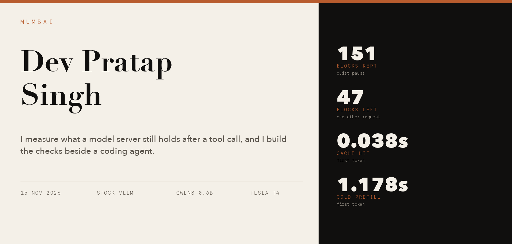
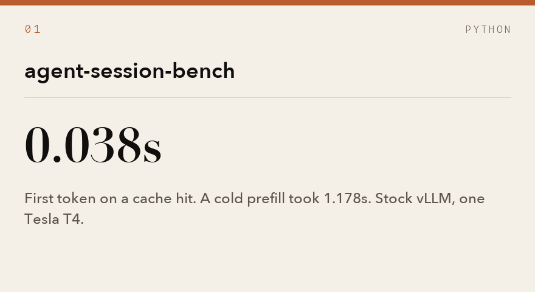
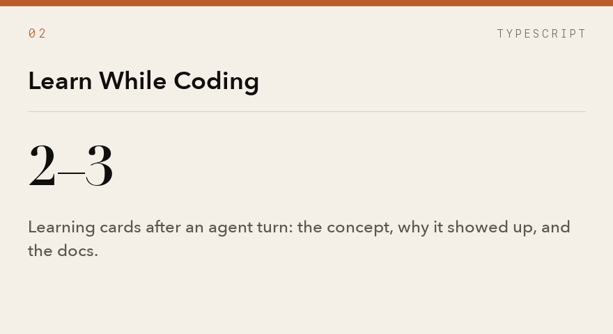
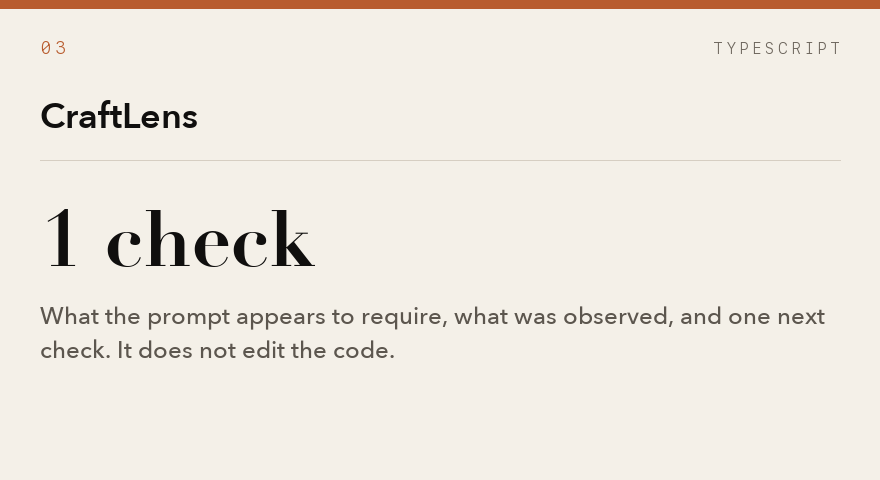
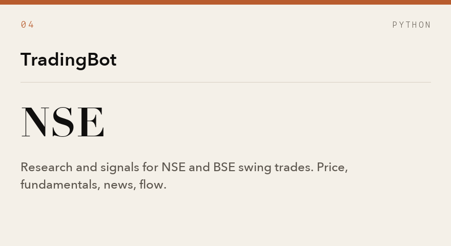

<table>
<tr>
<td width="50%">

</td>
<td width="50%">

</td>
</tr>
<tr>
<td width="50%">

</td>
<td width="50%">

</td>
</tr>
</table>

[Write-up](https://devps2003.github.io/agent-session-bench/) · [Bench source](https://github.com/Devps2003/agent-session-bench) · [Open VSX](https://open-vsx.org/extension/Devps2003/learn-while-coding-extension) · [LinkedIn](https://www.linkedin.com/in/dev-pratap-singh-6017b8223) · [X @devps03](https://x.com/devps03)
