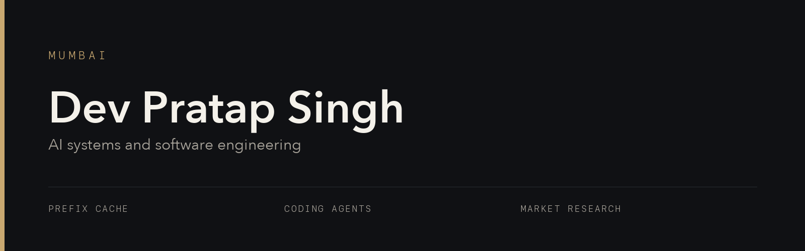

I measure what a model server still holds after an agent stops to call a tool, and I build the checks that sit beside a coding agent.

## Selected work

### [agent-session-bench](https://github.com/Devps2003/agent-session-bench)

Does a tool pause keep a vLLM prefix cache? Stock vLLM, Qwen3-0.6B in float16, one Tesla T4. The server was not modified. [Write-up](https://devps2003.github.io/agent-session-bench/)

| Quiet 30-second pause | One other request | Cache hit | Cold prefill |
| --- | --- | --- | --- |
| 151 blocks kept | 47 blocks left, 1,703 tokens read again | 0.038 s to the first token | 1.178 s to the first token |

Decode stayed near 13 ms either way. Saving the prefix changes the wait for the first new token. It does not make the rest of the answer faster.

### [Learn While Coding](https://github.com/Devps2003/learn-while-coding)

A VS Code and Cursor extension. After an agent turn it writes two or three cards: the concept, why it showed up in that session, and a link to the docs. [Open VSX](https://open-vsx.org/extension/Devps2003/learn-while-coding-extension)

### [CraftLens](https://github.com/Devps2003/craftlens)

A local panel beside a coding agent. For the task just asked, it keeps what the prompt appears to require, which risks are worth a look, what was actually observed, and one next check. It does not edit the code.

### [TradingBot](https://github.com/Devps2003/TradingBot)

Research and signals for NSE and BSE swing trades: price, fundamentals, news sentiment, and institutional flow.

## Stack

Python and TypeScript. vLLM for the serving measurements. VS Code extension APIs and Cursor hooks for the agent tools.

[X @devps03](https://x.com/devps03)
